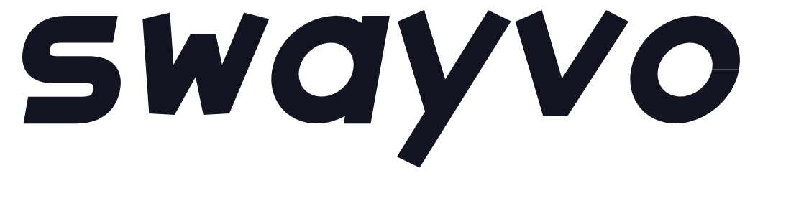
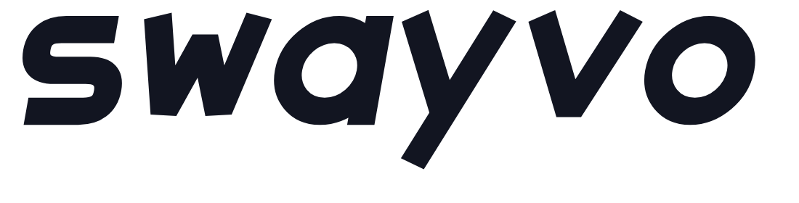
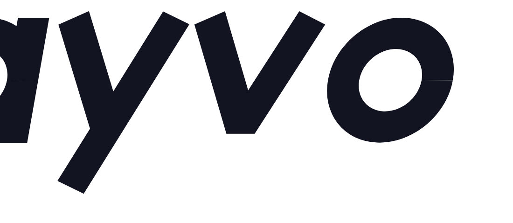
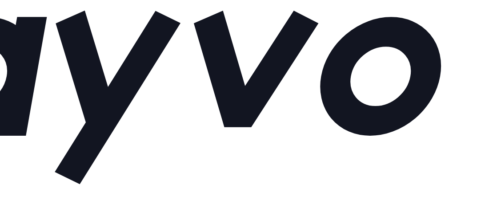

# Wordmark and icon, v2

**28 November 2026.** A type-designer pass on the Swayvo wordmark and app icon, from the round-2 brand
review (`docs/review/round2/panel-brand-experts.md` §5, REPORT §7 item 3). The identity is unchanged:
same strokes, same lean, same count. Three measured flaws are fixed.

The geometry lives in one place, `src/lib/swayvo-logo.ts`. Every file in `public/brand/`, `public/icons/`
and `src/app/icon.svg` was regenerated from it with `npx tsx scripts/brand-assets.mts`. The images on
this page come from `npx tsx scripts/wordmark-compare.mts before|after`.

## What changed

| Flaw (measured) | v1 | v2 | Change in `swayvo-logo.ts` |
|---|---|---|---|
| y–v gap between stroke edges, at x-height | **1 unit** | **5 units** | `v` and `o` move 4 units right (`translate(259 0)`, `translate(322 0)`) |
| Other pairs, for reference | s–w 6 · w–a 6 · a–y 4 · v–o 5 | unchanged (v–o stays 5) | — |
| Seam in the `o` (and the `a` bowl) | arc starts and ends at 3 o'clock (`…A21 21 0 1 1 49 27.9`), a hairline notch at large sizes | none | each bowl is two half-circles closed on itself (`…A21 21 0 0 1 7 28A21 21 0 0 1 49 28Z`) |
| App-icon bars at 180px | 6-unit bars, 2-unit gap: bars 2–4 and 6–8 nearly merge | 5-unit bars, 3-unit gap | `ICON_BARS` / `ICON_BAR_W` (the icon only; the mark in the app is unchanged) |
| Browser chrome colour | `themeColor` white in `layout.tsx`, Count blue in the manifest | one value, `THEME_COLOR` (studio white) | `layout.tsx` and `manifest.ts` both read it |

The wordmark still fits its 410 × 96 box and the 512 × 96 lockup, so no layout that uses the logo moves.

## Before and after

**Wordmark**

| v1 | v2 |
|---|---|
|  |  |

**"yvo", magnified.** In v1 the y and v nearly touch at the top and the `o` shows a hairline at three o'clock.

| v1 | v2 |
|---|---|
|  |  |

**App icon at 180px** (the iPhone home-screen size)

| v1 | v2 |
|---|---|
|  |  |

## Still to do

- Test the icon at real launcher sizes on a device (48–60dp), as the product panel asked. Not done here.
- Trademark clearance (GUIDELINES §9) is unchanged and still blocks launch.
